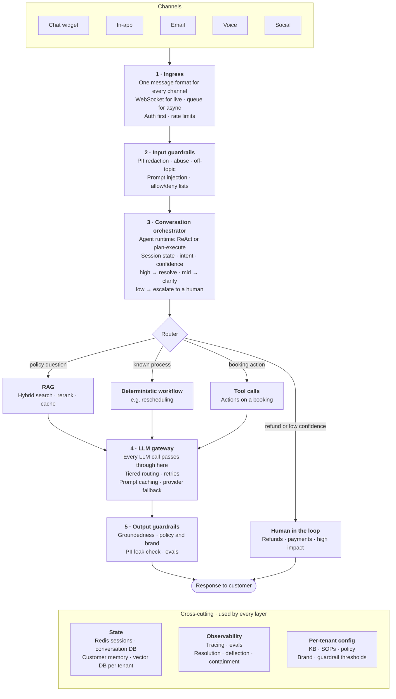

"Design an AI system that does X."

It's the classic system design question, rebuilt for AI, and it was one of the most important rounds in my AI Engineering interviews. The X changes from company to company: an agent that books tickets for an airline client, a chatbot that handles flight rescheduling, a customer support agent. What the round tests doesn't change. It shows the gap between people who've shipped and people who've read about shipping faster than any other round.

This is the rulebook I follow, worked through on one concrete problem, numbers included.

## Table of contents

## The problem

> Design an AI customer support agent for an airline client.

It should answer policy questions (baggage allowances, fare rules, cancellation terms), handle changes like rescheduling, take actions on bookings, and know when to hand a conversation to a human.

The rulebook has three phases, always in this order:

1. **Clarify scope**: what the system has to answer to.
2. **Estimate scale**: what the numbers say about where it gets hard.
3. **Architecture**: and only then.

The temptation is to invert it: open with a model and a vector database, then work backwards to the requirements. Resist it. The first two phases are where you show you've built a production system rather than a demo.

## Phase 1: Clarify scope

Six questions. None of them is about the model, and every one of them changes the design.

**1. What's the goal, and how is success measured?**
Resolution rate, cost per contact, customer satisfaction and handling time pull a design in different directions. A system tuned to keep conversations away from human agents looks very different from one tuned to actually resolve them. Pin the metric down first, because every later trade-off gets judged against it.

**2. What data exists, and what compliance comes with it?**
Booking records, fare rules, policy documents, past support tickets. Then the hard part: passenger data is full of PII (passport numbers, contact details, payment information), and customers will paste documents straight into the chat. This question decides what gets redacted, what can be logged, and which model providers are allowed to see what.

**3. One client, or a platform for many?**
If you're building for an airline client, ask whether other clients will follow. Multi-tenancy reshapes everything downstream: separate knowledge bases, separate policies, separate brand voices, and hard isolation so one airline's data never surfaces in another airline's conversation.

**4. Which actions run on their own, and which need a human to approve?**
Answering a baggage question is safe to automate. Changing a booking might be, with explicit confirmation from the customer. Issuing a refund probably isn't. This question defines the system's blast radius, and the answer becomes its escalation policy.

**5. Which channels?**
Chat, voice, email, social. Each brings its own latency budget: email tolerates minutes, chat tolerates a few seconds, and voice needs a reply in about a second for the conversation to feel natural. Voice also adds speech-to-text and text-to-speech at the edges. The answer here can change your model choices on its own.

**6. How many conversations, and how spiky?**
Which feeds straight into the next phase.

## Phase 2: Estimate scale

This is an essential part of any system design interview, and it's easy to skip in an AI round because it feels like a backend question. It isn't. It's where the most important constraint in the design shows up.

Assume **1 million conversations a month**:

| Quantity | Estimate |
| --- | --- |
| Conversations per day | 1M ÷ 30 ≈ **33,000** |
| Conversations per second | 33,000 ÷ 86,400 ≈ **0.4** |
| Peak, at 10× average | ≈ **4 per second** |
| LLM calls per conversation | ~6 turns × 1–3 calls per turn, call it **~10** |
| LLM calls per second | ≈ **4** on average, **~40** at peak |

A few notes on the assumptions:

- **The 10× peak isn't hypothetical for an airline.** A weather disruption sends rebooking requests in all at once, and that's exactly when the system matters most.
- **The 1–3 calls per turn** come from routing or intent classification, generation, and LLM-based guardrail checks.
- **Concurrency stays small.** If a conversation lasts around five minutes, the peak is about 4 × 300 = 1,200 live sessions. Session storage is not where this design gets hard.

### What the numbers say

QPS is modest. Each request is heavy and expensive.

That's the insight the estimate exists to surface: **this system is bound by cost and latency, not throughput.** Your own services handle forty calls a second easily, because they're stateless and scale horizontally, and if you're calling a hosted model, the provider runs the GPUs. What hurts is what each call costs and how long it takes. That one observation shapes half the architecture, and it's why the LLM gateway below earns a layer of its own.

### Putting a price on it

Assume ~3,000 input tokens per call (system prompt, policies, conversation history, retrieved context) and ~300 output tokens. Per conversation, that's ~30,000 input tokens and ~3,000 output tokens.

At an illustrative $3 per million input tokens and $15 per million output tokens:

- Input: 30,000 × $3 ÷ 1M ≈ $0.09
- Output: 3,000 × $15 ÷ 1M ≈ $0.045
- **Total: ≈ $0.135 per conversation, or roughly $135,000 a month**

Swap in your provider's current pricing; the method is the point. Saying this number out loud does two things. It shows you treat cost as a design constraint rather than an afterthought, and it gives every later decision (caching, model tiering, token caps) something concrete to move.

The same assumptions give you the one throughput number worth checking: tokens per minute against your provider's rate limits. At peak, that's 40 calls × ~3,300 tokens × 60 seconds ≈ 8 million tokens a minute. That's a quota conversation to have before launch, and another reason the gateway needs provider fallback.

### And latency

If a turn needs two or three LLM calls in sequence at one to two seconds each, a single turn takes several seconds. Fine for email. Tolerable for chat, with streaming. Unworkable for voice. That's the channel question from phase 1 paying off.

## Phase 3: Architecture

Five layers sit in the request path, plus three concerns that cut across all of them.

### Layer 1: Ingress

Customers arrive through a chat widget, the app, email, voice or social. The ingress layer normalises all of them into one internal message format, so nothing downstream needs to know where a message came from. Live channels hold a WebSocket; asynchronous ones like email go through a queue.

Authentication happens here, and it happens first: identify the customer and the tenant before anything reads a booking. Rate limiting lives here too.

### Layer 2: Input guardrails

PII redaction, abuse filtering, off-topic detection, prompt-injection detection, and allow and deny lists.

One nuance worth raising in the room: redaction can't simply delete. The agent may need a booking reference to do its job. Mask instead. The model sees a placeholder, and only the tool that genuinely needs the real value can resolve it. The model never needs to see a raw card number.

### Layer 3: Conversation orchestrator

The agent runtime. It holds session state, tracks the customer's intent, and keeps a running estimate of its own confidence. Depending on how multi-step the task is, it runs a ReAct-style loop or plan-and-execute.

The key design decision here: **not every message needs an agent.** A lightweight router in front (or the agent itself) sends each message down one of four paths:

1. **RAG** for policy and FAQ questions. A vector database with hybrid search, because fare codes and fare class names are exact strings that pure vector search handles poorly. A reranker on top, and a cache for the questions everyone asks.
2. **Deterministic workflow** for processes with known steps. Rescheduling is: find the booking, check the fare rules, fetch options, confirm, execute. A workflow is cheaper, faster and auditable. An agent improvising its way through the same steps adds risk without adding anything.
3. **Tool calls** for actions on a booking: seat changes, notifications, booking APIs. Every write carries an idempotency key, so a retry never double-books, and anything irreversible waits for the customer's explicit confirmation.
4. **Human in the loop** for refunds, payments and any decision with real business impact. The handoff carries a summary of the conversation, so the customer never has to repeat themselves.

Confidence governs the boundaries between them: **high → resolve, medium → ask a clarifying question, low → escalate.**

Each path goes as deep as the problem requires, and in the interview, which one you go deep on is the interviewer's call. Draw all four, then ask where they'd like to start.

### Layer 4: LLM gateway

Every LLM call in the system passes through one gateway, which handles:

- **Tiered model routing**: a small, fast model for classification and routing, and the expensive model only where the reasoning demands it.
- **Retries** with backoff.
- **Prompt caching**: static instructions and policies first, variable context last, so the cached prefix gets reused across calls.
- **Provider fallback**: if a provider is down or rate-limiting, traffic fails over to another.

Phase 2 showed this system is bound by cost and latency. This is the layer where both get managed, and the natural place to attribute cost per tenant.

### Layer 5: Output guardrails

Before anything reaches the customer:

- **Groundedness**: is the answer actually supported by the retrieved policy or the tool result?
- **Policy and brand**: no promises the airline doesn't make, in the voice the client expects.
- **PII leak checks**: never another customer's data.
- **Evals**: a sample of live responses, scored continuously.

None of this is paranoia. In February 2024, a Canadian tribunal held Air Canada liable after its website chatbot gave a customer wrong information about bereavement fare refunds, and rejected the airline's argument that the chatbot was responsible for its own actions ([ABA Business Law Today](https://www.americanbar.org/groups/business_law/resources/business-law-today/2024-february/bc-tribunal-confirms-companies-remain-liable-information-provided-ai-chatbot/)). Whatever your bot says, the company said.

### Cross-cutting concerns

**State**

- Redis for live session state
- A conversation database for history and audit
- Customer profile and memory, for context across conversations
- A vector database with a namespace per tenant, so one client's knowledge never answers another client's customer

**Observability**

Trace every conversation end to end: each LLM call, each tool call, latency and cost. Feed that into the metrics the business actually tracks (resolution, deflection and containment) alongside the evals from layer 5.

Track containment and resolution separately. A bot that never escalates has perfect containment and furious customers.

**Configuration**

The knowledge base, SOPs, policies, brand voice and guardrail thresholds all live as per-tenant configuration, not code. Onboarding a new airline client should be a config change, not a deploy.

## Notice what's missing

Almost none of this answer is about which model to use. The model sits behind the gateway, swappable by design.

What the round actually tests is whether you can see the system around the model: what it has to answer to, what it costs, where it fails, and where a human has to stay in the loop.

A rough budget for a 45-minute round:

| Phase | Time |
| --- | --- |
| Clarify scope | ~5 min |
| Estimate scale | ~5 min |
| Draw the layers | ~10 min |
| Deep dive, interviewer's choice | ~20 min |
| Trade-offs and wrap-up | ~5 min |

Get the boxes on the board early. The deep dive is where the round is won, and you can't get there if you're still drawing at minute thirty.
